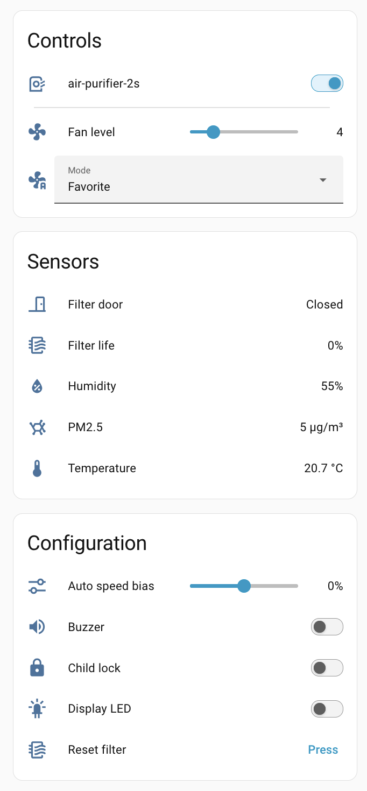
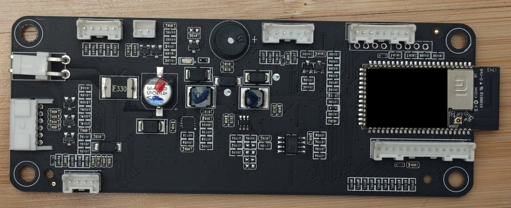
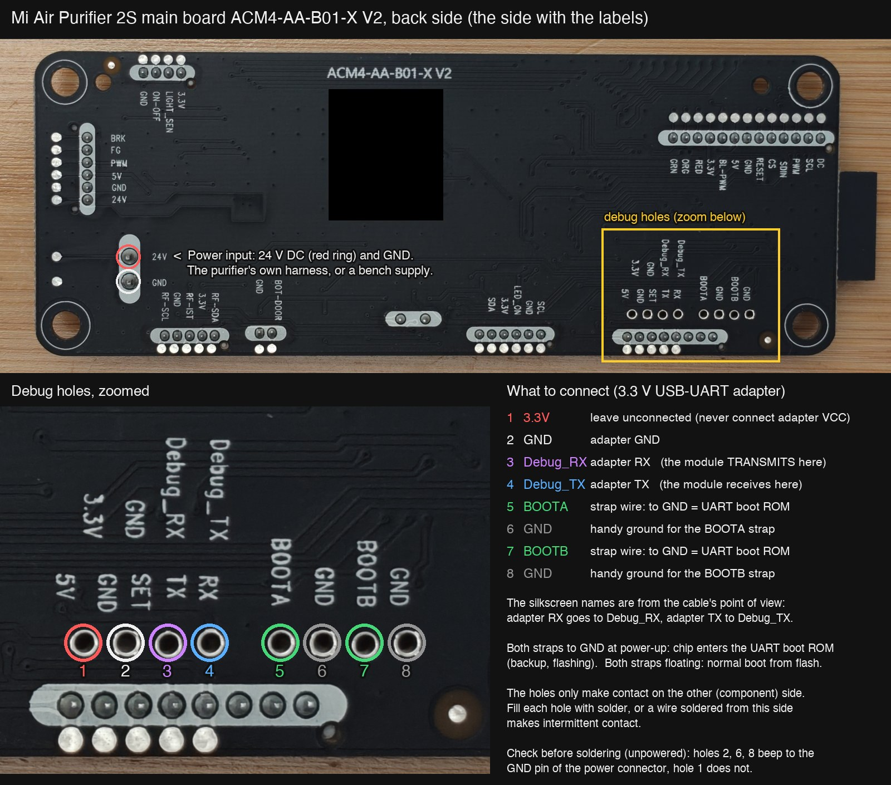

# Local firmware for the Xiaomi Mi Air Purifier 2S (Home Assistant, no cloud)

Replacement firmware for the **Mi Air Purifier 2S** (`zhimi.airpurifier.mc1`, label AC-M4-AA). It runs on the purifier's own Wi-Fi module (Xiaomi `MHCW02P`, a Marvell 88MW300), behaves like the stock firmware, and shows up in Home Assistant through the built-in **ESPHome integration**. No Xiaomi cloud, no Mi Home app, no extra hardware left inside the purifier.

> ### AI Slop disclaimer
> Everything in this repository was generated by an AI (Claude): the firmware, the flashing tools, the reverse engineering it is based on, the tests, the pictures and this README. A human supervised, soldered and flipped the power switch, but did not write or line-by-line review the code. (I did check the photos, and the purifier works, so use this repo as you wish with that in mind.)
>
> It runs on exactly one purifier, in daily use under Home Assistant, installed with exactly the steps below.
>
> What that means for you: one unit is the whole test fleet. Your board revision, flash chip or stock firmware may differ. You can brick the Wi-Fi module (which is the purifier's only processor), you are soldering on a mains-powered appliance's control board, and nobody will support you. **Take the flash backup first, and read what a command does before you run it.** No warranty of any kind.

You are expected to do this with an LLM coding assistant at your side (that is how it was made). The repo is small on purpose so that an assistant can read all of it.

## What you get in Home Assistant



- **Fan** with on/off, 15 speed levels and presets Auto / Silent / Favorite (also as separate *Mode* and *Fan level* entities)
- **Sensors:** PM2.5, temperature, humidity, fan rpm, filter life and hours, ambient light, Wi-Fi signal
- **Switches:** display, buzzer, child lock. **Buttons:** reset filter, restart
- **Extras:** *Auto speed bias* (make Auto mode run faster or slower than stock), filter door, motor and PM-sensor fault sensors, uptime/heap/reset-reason diagnostics, device logs in the ESPHome log viewer
- **Updates over Wi-Fi** with an A/B slot scheme: a new image runs on trial and the purifier falls back to the previous one if it is not confirmed

Not done: the filter's RFID tag is ignored (filter life is counted in hours), there is no HA `update` entity (updates use a script), and there is no hardware watchdog. The full entity list and design are in [firmware/ARCHITECTURE.md](firmware/ARCHITECTURE.md).

## How it works, in one paragraph

The module has a UART boot ROM. With two strap pins grounded, the ROM accepts a small program over the debug UART and runs it from RAM. We use that to (1) read the whole 2 MB flash as a backup and (2) write our image into the **inactive** of the two app slots and switch the partition table to it. The bootloader, the Xiaomi config area and the other slot (stock) are never written, so until your first over-the-air update the stock firmware is still there as a fallback. After that, updates go over Wi-Fi and the purifier stays closed.

## What you need

- The purifier, and patience: getting to the board is the worst part.
- A **3.3 V USB-UART adapter**: FTDI, CP2102, CH340, the UART side of a Raspberry Pi Debug Probe, anything. 3.3 V logic only, and it must be able to send a *break* (hold TX low); most can. No SWD/JTAG probe is needed.
- Soldering iron, thin wire (5 wires), a multimeter.
- 24 V DC for the board on the bench: a current-limited bench supply (24 V, 0.3 A limit) is the safe choice. The purifier's own power board also works, but then mains voltage is on your desk.
- A computer with Python 3 and `pyserial`, an `arm-none-eabi-gcc` toolchain (tested with 10.3.1; other versions are untested), `make`, and `git`. Developed on macOS; Linux should work, Windows only via WSL.
- 2.4 GHz Wi-Fi and Home Assistant with the ESPHome integration.

## Step 1: open it and wire it

1. Unplug mains. Remove the filter, turn the unit upside down, remove the feet, the bottom cover and the power board. Then the left and right side panels (hidden clips, they break easily), then the front panel. The main board sits behind the front panel; release the display ribbon's latch instead of pulling the cable. Search for a "Mi Air Purifier 2S teardown" before you start.
2. Check that your board matches: `ACM4-AA-B01-X V2`, with a metal-can module marked `MHCW02P`. If it differs, stop and investigate first.

   

3. Solder five wires to the 8 unpopulated debug holes next to the module, as in the picture: GND, `Debug_RX`, `Debug_TX`, `BOOTA`, `BOOTB`. Leave the `3.3V` hole alone.

   

   Things that cost hours the first time:
   - **The labels are from the cable's point of view.** Adapter **RX → `Debug_RX`**, adapter **TX → `Debug_TX`**, GND → GND. Never connect the adapter's VCC.
   - **Fill the holes with solder.** They only make contact on the component side; a wire tacked on from the label side gives a flaky connection that looks like "the chip doesn't answer".
   - **`BOOTA` and `BOOTB` both to GND** = UART boot ROM at power-up (for the backup and the flashing). Both **floating** = normal boot.
   - The adapter's TX line feeds the chip a little power even with 24 V off, so a quick off/on is not a real reset. The tools work around it (the *gate*, below); when in doubt, unplug the adapter too and wait.
4. For the bench work unplug all harnesses from the board and power it with 24 V on the 2-pin connector.

## Step 2: back up the stock flash (do not skip)

```sh
pip install pyserial
cd flash
python3 uartboot_load.py --self-test        # offline sanity check
```

Every tool talks to the boot ROM right after power-on. The reliable way to start one is the **gate**: the tool holds TX low until a file appears, then you switch the power on.

1. Straps grounded, 24 V **off**, adapter plugged in. Make sure the gate file does not exist: `rm -f /tmp/go`.
2. Start the tool with `UARTBOOT_GATE` set (replace the port with yours: `/dev/ttyUSB0`, `/dev/cu.usbserial-…`, …):

   ```sh
   UARTBOOT_GATE=/tmp/go python3 uartboot_load.py --port /dev/ttyUSB0
   ```

3. Wait about 5 seconds (the tool is holding TX low so the board can discharge). Then, in a second terminal, `touch /tmp/go`, and switch the 24 V **on**.

The tool should print `ROM version 01 00 41 0a  ack 0xa3`, then read the flash for about 3 minutes into `backup/mw300-flash-<time>.bin` (at the top of this repo) and check its CRC. (`ack 0xac` means your chip has boot security enabled; this project cannot help then.)

**Do it twice and compare the two files' SHA-256.** The backup program does not return to the boot ROM when it finishes, so every run needs the whole procedure again, starting with 24 V off and `rm -f /tmp/go`.

No answer at all? Check the solder joints first, then RX/TX, then the straps. `python3 uartboot_hello.py PORT 115200 20` (started, then power on) prints the ROM's raw reply; the tools only accept ROM version `01 00 41 0a`, so a different version also shows up as "no answer". Keep the backup somewhere safe and **private**: it contains your device's Xiaomi token and your Wi-Fi password. It is the only way back to stock once you have updated over the air.

## Step 3: build the firmware

```sh
# The vendor SDK (Amazon FreeRTOS with the Marvell WMSDK). Big; not redistributed here.
git clone https://github.com/aws/amazon-freertos ~/sdk/amazon-freertos
cd ~/sdk/amazon-freertos
git checkout 41244b002675843d44fc79c8752a87c344eaa855
git submodule update --init freertos_kernel libraries/freertos_plus/standard/freertos_plus_tcp
```

```sh
cd firmware                         # back in this repo
cp secrets.example.h secrets.h      # then edit it
make -j8 && make check              # -> build/purifier.mrvl
```

In `secrets.h` set your Wi-Fi name and password, a long random `OTA_PASSWORD`, and an `API_ENCRYPTION_KEY` (`openssl rand -base64 32`). **These are compiled into the image.** If you later change your Wi-Fi password without updating the purifier first, it is offline and you are back to soldering, so consider setting the optional rescue network (`WIFI_SSID_2`, e.g. a phone hotspot). `make check` must end with `check: PASS`, `secrets.h: customized` and `API_ENCRYPTION_KEY: valid`.

The Wi-Fi region defaults to the EU (channels 1-13). Elsewhere build with e.g. `make NET_WIFI_COUNTRY=COUNTRY_US` (names as in the SDK's `wlan.h`); only the EU setting has run on hardware.

Use `make AFR=/path/to/amazon-freertos` or `TOOLCHAIN=/path/to/bin` if yours live elsewhere. Our Makefile compiles the SDK sources itself; the SDK's own build scripts are not used. Optional host tests are listed in [firmware/ARCHITECTURE.md](firmware/ARCHITECTURE.md#tests).

## Step 4: flash it over UART

From `flash/`, straps still grounded. Start the **first** command with the full gate procedure from step 2 (24 V off, `rm -f /tmp/go`, start it, wait 5 s, `touch /tmp/go`, 24 V on). Then leave the gate file and the power alone: the writer returns to the boot ROM after each operation, so the following commands run without another power cycle. If one gets no answer, repeat the full gate procedure for it.

```sh
export UARTBOOT_GATE=/tmp/go
P=/dev/ttyUSB0
python3 uartboot_flash.py --port $P status                                       # read-only: must show two VALID tables, booting slot A
python3 uartboot_flash.py --port $P write-slot-b ../firmware/build/purifier.mrvl # ~90 chunks, a few minutes, verified by CRC
python3 uartboot_flash.py --port $P activate b                                   # the only step that changes what boots
```

If `status` does not show two valid tables with slot A active, stop: your flash layout differs from the tested unit. The writer program refuses, on the device itself, to touch anything except slot B and the inactive partition-table copy.

Now **release both straps** and boot it. To watch the boot log, use the gate trick again, because a terminal program that keeps TX high can back-power the chip into not booting:

1. 24 V off. Run `python3 gated_listen.py PORT boot.log /tmp/go2 300` and, in another terminal, `tail -f boot.log`.
2. Wait 5 s, `touch /tmp/go2`, switch the 24 V on.

You should see the firmware start and join your Wi-Fi. (Or skip the log, disconnect the adapter's TX wire and just look for the device on your network.) On the tested board it sometimes took a few power-ups before it booted from flash on the bench.

The new image boots **on trial**, and the trial is strict:

- It becomes permanent when Home Assistant has been connected to it for a while (step 5; it confirms itself from 5 minutes after boot), or when you run `python3 ../firmware/tools/ota_upload.py --host air-purifier-2s.local --password YOUR_OTA_PASSWORD --confirm-only` (accepted from 2.5 minutes after boot).
- Unconfirmed after 10 minutes, it reboots into stock.
- **Until it is confirmed, any power cycle or reset also boots stock.** So leave it powered until `ota_upload.py --host … --version` shows `"trial": false` (or the *OTA slot* entity in Home Assistant no longer says "trial").

Landing back on stock is the safety net, not a failure: ground the straps and run `activate b` again.

**Back to stock at any time before your first over-the-air update:** ground the straps and run `python3 uartboot_flash.py --port $P activate a`.

## Step 5: add it to Home Assistant

Nothing to install: the firmware speaks the ESPHome native API, so Home Assistant's stock **ESPHome** integration handles it.

1. *Settings → Devices & services*. The purifier should be discovered as **air-purifier-2s**. If not: *Add integration → ESPHome*, host `air-purifier-2s.local` (or its IP), port 6053.
2. Enter the `API_ENCRYPTION_KEY` from your `secrets.h` when asked.
3. Speed and presets are in the fan's more-info dialog; *Mode* and *Fan level* are also on the device page.

Once the trial is confirmed (see step 4), power off, plug the harnesses back in, check that the sensors show sane values, test the fan, and only then reassemble.

## Step 6: updates over Wi-Fi

```sh
cd firmware && make -j8 && make check
python3 tools/ota_upload.py --host air-purifier-2s.local --password YOUR_OTA_PASSWORD build/purifier.mrvl
```

The upload goes into the inactive slot, is verified, runs on trial and is confirmed by the script; a bad image falls back to the previous one. Do one such update **before reassembling** so you know it works, because from then on this is the only way in. Two things to know:

- **The first over-the-air update overwrites the stock firmware** (there are only two slots). From then on, going back to stock means opening the purifier and writing the stock app image from your backup into slot B with the UART tools. **Untested** outline: cut the image out of the backup (`dd if=backup.bin of=stock-app.mrvl bs=4096 skip=10 count=128`), then `activate a` (needed first: it writes a clean table, without it the writer refuses with `layout`), `write-slot-b stock-app.mrvl`, `activate b`.
- The OTA password travels unencrypted over HTTP on your LAN. Keep the purifier on a network you trust.

## What is in here

| Path | What |
|---|---|
| [firmware/](firmware/) | The firmware: purifier logic, hardware drivers, ESPHome API server, OTA, Wi-Fi; host tests; image packer and `ota_upload.py`. Start with [ARCHITECTURE.md](firmware/ARCHITECTURE.md). |
| [flash/](flash/) | UART boot ROM tools: flash dumper (`uartboot_load.py`), guarded flash writer (`uartboot_flash.py`), their RAM programs (source plus the exact binaries that ran on hardware), offline tests. |
| [docs/](docs/) | The two pictures. |

Source comments refer to reverse-engineering notes (`evidence/*.md`) and stock firmware addresses. Those notes are not published here; the comments are left in as breadcrumbs.

## Tested on

One unit: board `ACM4-AA-B01-X V2`, module `MHCW02P` (88MW300), flash Winbond W25Q16 (JEDEC `EF4015`), boot ROM version `01 00 41 0a` without boot security, stock firmware from 2019. Built on macOS with `arm-none-eabi-gcc` 10.3.1. Anything else is unknown territory.

## License

[MIT](LICENSE) for everything written for this project. Third-party code keeps its own license: Monocypher (`firmware/src/esphome/crypto/monocypher`) and the Mbed TLS SHA-256 (`firmware/src/esphome/crypto/mbedtls`). The vendor SDK is not included, but `firmware/platform/purifier.ld` is derived from its linker script (Marvell copyright, see the file header) and `firmware/platform/board.c` contains small Wi-Fi power tables taken from the stock firmware. Not affiliated with Xiaomi, Smartmi, ESPHome or Home Assistant.
